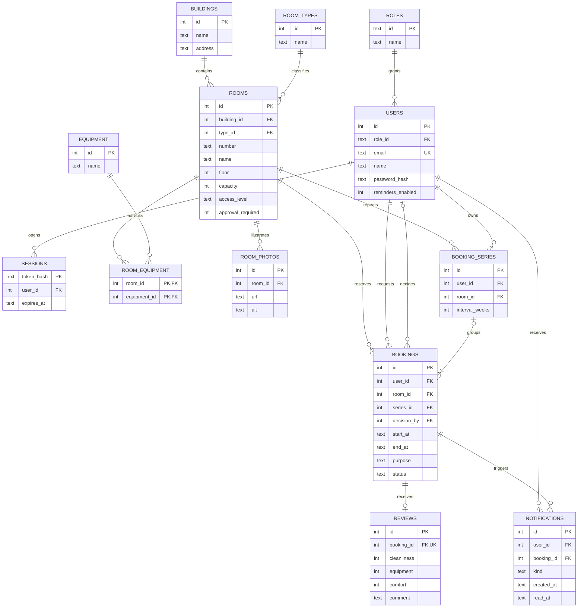

# Модель данных CampusSpace

SQLite содержит 13 сущностей. Заявка на согласовании удерживает слот до решения администратора или отмены. Время хранится в UTC. Соседние интервалы могут соприкасаться, поскольку конец интервала в него не входит.

